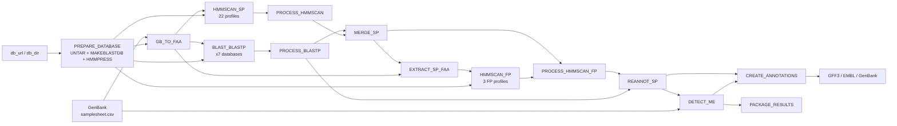

# advena

**advena** is a Nextflow pipeline for ICEscreen: detection and annotation of Integrative and Conjugative Elements (ICEs)
and Integrative and Mobilizable Elements (IMEs) in Bacillota genomes.

This pipeline is a Nextflow DSL2 reimplementation of the original [ICEscreen](https://github.com/ICEscreen/ICEscreen)
Snakemake workflow, combining standard [`nf-core/modules`](https://github.com/nf-core/modules) for database preparation,
BLAST+, and HMMER with containerized ICEscreen Python tools (`ghcr.io/andreassag/icescreen:v1.3.3`).

## Features

- ICE/IME structure detection and boundary assembly using the [ICEscreen](https://github.com/andreassag/icescreen)
  v1.3.3 logic
- Automatic database download/extraction (`UNTAR`), protein BLAST DB indexing (`BLAST_MAKEBLASTDB`), and HMM profile
  compression (`HMMER_HMMPRESS`) via `nf-core/modules`, with optional local caching via `--db_dir`
- Parameter and samplesheet validation via [`nf-schema`](https://nextflow-io.github.io/nf-schema)
- Support for Docker, Singularity, Apptainer, Podman, and Conda

## Requirements

- [Nextflow](https://www.nextflow.io/) >= 25.10.0 (Java >= 17)
- One of: Docker, Singularity, Apptainer, Podman, or Conda

## Quick Start

```bash
nextflow run andreassag/advena \
    --input assets/samplesheet.csv \
    --outdir results \
    -profile docker
```

To verify the pipeline with the bundled test dataset:

```bash
nextflow run andreassag/advena \
    -profile test,docker
```

See the [documentation](https://andreassag.github.io/advena) for full details.

## Input

A CSV samplesheet with one row per genome:

| Column    | Description                                      |
| --------- | ------------------------------------------------ |
| `sample`  | Unique sample identifier (no spaces)             |
| `genbank` | Path to GenBank file (`.gb`, `.gbk`, or `.gbff`) |

```csv
sample,genbank
genome_A,/path/to/genome_A.gbff
genome_B,/path/to/genome_B.gbff
```

## Parameters

| Parameter                  | Default                                                                                      | Description                                                     |
| -------------------------- | -------------------------------------------------------------------------------------------- | --------------------------------------------------------------- |
| `--input`                  | (required)                                                                                   | Path to samplesheet CSV                                         |
| `--outdir`                 | `results`                                                                                    | Output directory                                                |
| `--phylum`                 | `bacillota`                                                                                  | Taxonomic phylum (`bacillota`)                                  |
| `--db_url`                 | `https://github.com/andreassag/icescreen/releases/download/v1.3.3/icescreen_database.tar.gz` | URL or path to ICEscreen database archive (`.tar.gz`)           |
| `--db_dir`                 | `null`                                                                                       | Directory containing pre-extracted DB or local extraction cache |
| `--blastp_evalue`          | `0.001`                                                                                      | E-value threshold for BLASTP                                    |
| `--blastp_max_target_seqs` | `10`                                                                                         | Max target sequences per BLASTP query                           |

## Output

Results are organized per sample under `<outdir>/ICEscreen_results/<sample>/`:

```text
<outdir>/
├── ICEscreen_results/
│   └── <sample>/
│       ├── detected_mobile_elements/
│       │   ├── <sample>_detected_ME.tsv
│       │   ├── <sample>_detected_ME.summary
│       │   ├── <sample>_detected_SP_withMEIds.tsv
│       │   └── standard_genome_annotation_formats/
│       │       ├── <sample>_icescreen.gff.gz
│       │       ├── <sample>_icescreen.embl.gz
│       │       ├── <sample>_icescreen.gb.gz
│       │       ├── <sample>_source.fa.gz
│       │       └── <sample>_source.gff.gz
│       ├── detected_signature_proteins/
│       │   └── <sample>_detected_SP.tsv
│       ├── param.conf.gz
│       └── tmp_intermediate_files.tar.gz
└── pipeline_info/
    ├── execution_report_<timestamp>.html
    ├── execution_timeline_<timestamp>.html
    ├── execution_trace_<timestamp>.txt
    ├── pipeline_dag_<timestamp>.html
    └── software_versions.yml
```

## Profiles

Combine a container engine profile with optional execution profiles:

```bash
-profile docker               # Docker
-profile singularity,hpc      # Singularity on an HPC cluster
-profile singularity,slurm    # SLURM cluster with Singularity
-profile apptainer            # Apptainer
-profile podman               # Podman
-profile conda                # Conda (local)
-profile test,docker          # Test dataset with Docker
```

## Pipeline Overview



## Citations

If you use this pipeline, please cite:

> Lao, J., Lacroix, T., Guedon, G., et al. ICEscreen: a tool to detect Firmicute ICEs and IMEs, isolated or integrated
> in genomes. _NAR Genomics and Bioinformatics_, 2024.

See [CITATIONS.md](CITATIONS.md) for a complete list of tools used by this pipeline.

## License

This project is licensed under the [GNU Affero General Public License v3.0](LICENSE).
