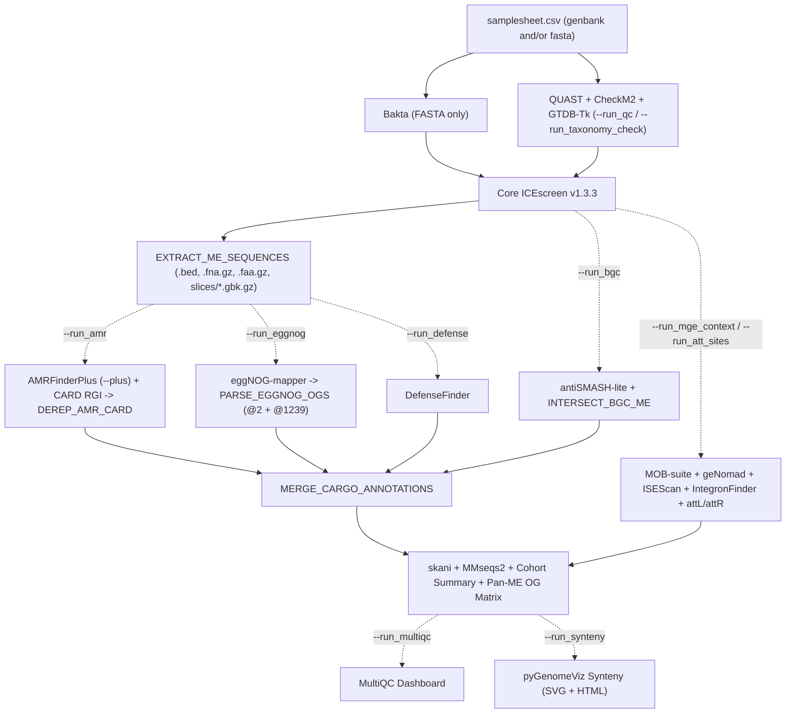

# advena

**advena** (v2.0.0) is a modular Nextflow DSL2 pipeline for **mobileome discovery, cargo profiling, and comparative
genomics** of Integrative and Conjugative Elements (ICEs) and Integrative and Mobilizable Elements (IMEs) in _Bacillota_
genomes.

---

## Architecture Overview



---

## Key Capabilities

- **Core ICEscreen v1.3.3 + always-on element extraction**: Byte-identical ICE/IME detection plus BED, nucleotide,
  protein, GFF3, and per-element GenBank slicing
- **Flexible inputs & pre-QC**: GenBank and/or raw FASTA assemblies (Bakta), QUAST, CheckM2, and GTDB-Tk phylum checks
- **Dereplicated AMR & stress cargo**: AMRFinderPlus (`--plus`) + CARD RGI merged natively via `DEREP_AMR_CARD`
- **eggNOG Orthologous Groups**: Hierarchical Bacteria (`@2`) and Bacillota (`@1239`) OGs, COG categories, and pan-ME OG
  presence/absence matrices
- **Defense, BGC & MGE context**: DefenseFinder, antiSMASH-lite, MOB-suite, geNomad, ISEScan, IntegronFinder, and
  `attL`/`attR` hotspot detection
- **Cohort clustering & visualization**: `skani` (`--small-genomes`), `MMseqs2`, `MultiQC`, and `pyGenomeViz`

---

## Quick start

```bash
nextflow run andreassag/advena \
    --input samplesheet.csv \
    --outdir results \
    -profile docker
```

See [Installation](installation.md), [Usage](usage.md), [Parameters](parameters.md), and [Output](output.md) for full
details.
