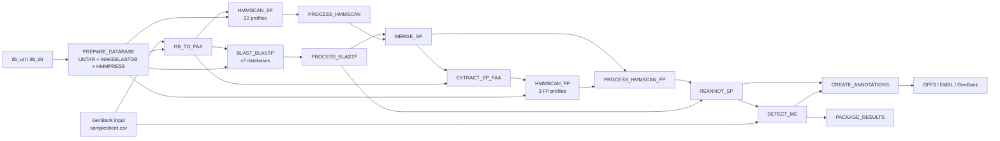

# advena

**advena** is a Nextflow pipeline for ICEscreen: detection and annotation of Integrative and Conjugative Elements (ICEs)
and Integrative and Mobilizable Elements (IMEs) in Bacillota genomes.

This pipeline is a Nextflow DSL2 reimplementation of the original [ICEscreen](https://github.com/ICEscreen/ICEscreen)
Snakemake pipeline, combining standard [`nf-core/modules`](https://github.com/nf-core/modules) with containerized
[ICEscreen](https://github.com/andreassag/icescreen) Python tools (`ghcr.io/andreassag/icescreen:v1.3.3`).

---

## Overview



---

## Features

- ICE/IME structure detection and boundary assembly using the [ICEscreen](https://github.com/andreassag/icescreen)
  v1.3.3 logic
- Automatic database retrieval and indexing via `nf-core/untar`, `nf-core/blast/makeblastdb`, and
  `nf-core/hmmer/hmmpress`
- Parameter and samplesheet validation via `nf-schema`
- Support for Docker, Singularity, Apptainer, Podman, and Conda

---

## Quick start

```bash
nextflow run andreassag/advena \
    --input samplesheet.csv \
    --outdir results \
    -profile docker
```

See [Installation](installation.md) and [Usage](usage.md) for full details.
